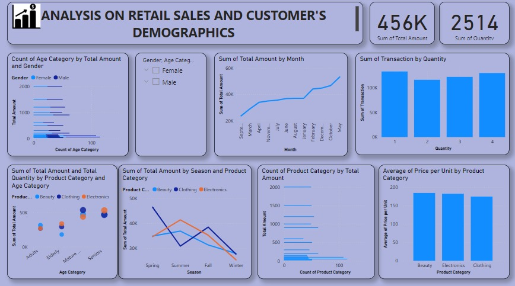

# Retail Sales and Customer Demographics Analysis

## Project Overview
This project explores retail sales performance and customer purchasing patterns through a dashboard. It presents sales across customer age categories and gender, product categories, seasons, transaction quantities, and monthly trends.

The objective is to make retail data easier to explore and support decisions about product performance, customer segmentation, and sales planning.

## Business Questions
- How does the displayed sales amount vary across customer age categories and gender?
- How do sales compare across product categories?
- How does sales performance vary by season and month?
- How are transaction quantities distributed?
- How does average unit price differ by product category?

## Dashboard Preview

## Metrics Shown in the Screenshot
| Metric | Displayed value |
|---|---:|
| Sum of Total Amount | 456K |
| Sum of Quantity | 2,514 |

These are values transcribed from the dashboard screenshot. The original dataset, currency, reporting scope, and calculations are not currently available for verification.

## Dashboard Sections
- Customer age category and gender
- Monthly sales trend
- Transaction count by quantity
- Sales and quantity by product category and age category
- Sales by season and product category
- Product category counts
- Average unit price by product category

## Tools
The screenshot appears to be a business-intelligence dashboard.

## Business Relevance
The dashboard structure could help retail stakeholders investigate customer segments, product performance, seasonality, and pricing. Specific business conclusions should be added only after the underlying data and calculations are recovered or recreated.

## Files and Limitations
- `images/retail-sales-dashboard.jpg` is the available visual preview.
- The original dataset and interactive project file are currently unavailable.
- The README intentionally does not claim findings that cannot be verified from the screenshot.

## Author
**Miracle Maduabuchi**  
[GitHub](https://github.com/miraclenagorom)
